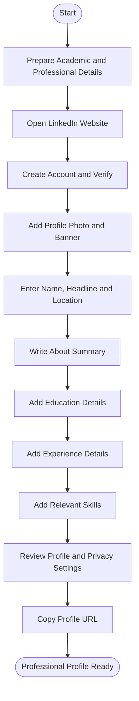

# Ex.No. 11 – Creating a Simple Professional Profile Page on LinkedIn

## AIM

To understand the importance of maintaining a professional online presence and to create a simple, complete, and professional LinkedIn profile page by highlighting academic qualifications, skills, interests, and professional experience in a clear and organised manner.

---

## INTRODUCTION

In today's digital world, maintaining a professional online identity is important for students, faculty members, and working professionals. Recruiters and organisations frequently use professional networking platforms to discover candidates, understand their qualifications, and evaluate their professional interests.

LinkedIn provides a platform where individuals can present their academic background, technical skills, achievements, projects, certifications, and work experience. A well-maintained LinkedIn profile acts as an online professional resume and helps individuals build connections with people from different industries.

This practical demonstrates the process of creating and organising a professional LinkedIn profile.

---

## WHAT IS LINKEDIN?

LinkedIn is a professional networking website used by students, faculty, and working professionals to showcase their education, skills, and experience; connect with peers and recruiters; and discover jobs, internships, and industry updates.

A well-built LinkedIn profile acts like an online resume that is visible to the professional community. Therefore, it should be accurate, complete, and presented in a clean, readable format.

### Main Features of LinkedIn

1. **Professional Profile:** Create an online profile containing personal, academic, and professional information.
2. **Networking:** Connect with classmates, faculty members, alumni, recruiters, and industry professionals.
3. **Job and Internship Opportunities:** Search and apply for job openings and internships.
4. **Skill Endorsements:** Allow connections to endorse skills listed on a profile.
5. **Recommendations:** Receive professional recommendations from people who have worked or studied with you.
6. **Learning and Development:** Discover professional courses, industry updates, and learning resources.
7. **Professional Branding:** Share projects, achievements, certifications, and technical knowledge.

---

## OBJECTIVES

- To understand the importance of a professional online presence.
- To learn how to create a LinkedIn account.
- To understand the different sections of a LinkedIn profile.
- To present academic qualifications and professional experience effectively.
- To identify and add relevant technical and soft skills.
- To understand LinkedIn's networking and career development features.
- To configure profile visibility and privacy settings.
- To create a shareable professional profile link.

---

## TOOLS REQUIRED

| S.No. | Tool / Requirement | Purpose |
|---|---|---|
| 1 | Web browser (Google Chrome / Microsoft Edge) | Accessing LinkedIn |
| 2 | LinkedIn mobile application (Optional) | Creating and managing the profile |
| 3 | Valid email ID or phone number | Registering and verifying the account |
| 4 | Recent professional photograph | Profile picture |
| 5 | Academic and professional information | Completing profile sections |
| 6 | Background / cover image (Optional) | Improving profile appearance |
| 7 | Internet connection | Accessing LinkedIn services |

**Website:** https://www.linkedin.com/

---

## LINKEDIN PROFILE STRUCTURE

A professional LinkedIn profile consists of several important sections.

| Profile Section | Description |
|---|---|
| Profile Photo | A clear and professional photograph |
| Background Banner | An image representing the individual's field or interests |
| Name | Full professional name |
| Headline | Short description of the current role or professional identity |
| Location | City and country |
| About | Brief introduction describing interests, goals, and specialisation |
| Education | Academic qualifications and institutions |
| Experience | Employment, internships, and relevant professional roles |
| Skills | Technical and non-technical abilities |
| Certifications | Courses and professional certifications |
| Projects | Academic, technical, and personal projects |
| Contact Information | Relevant professional contact details |

---

## PROCEDURE

### Step 1: Preparing Your Information

Before creating the profile, prepare the basic details offline in a document.

The information should include:

- Full name
- Current designation (e.g., Student, Professor, or Engineer)
- Institution or organisation name
- Location
- A short About summary (3–5 sentences)
- Educational qualifications
- Work or internship experience, if available
- Technical and soft skills
- Certifications and achievements, if available

Preparing this information in advance makes the profile creation process faster and avoids incomplete or hurried entries.

### Step 2: Signing Up on LinkedIn

1. Open a web browser such as Google Chrome or Microsoft Edge.
2. Visit https://www.linkedin.com/.
3. Click the **Join now** option.
4. Enter a valid email address or phone number.
5. Create a secure password.
6. Enter your first name and last name.
7. Complete the account verification process using the OTP or confirmation link sent to your registered email address or phone number.
8. Follow the on-screen instructions to complete the initial account setup.

### Step 3: Adding a Profile Photo and Background Image

After logging in:

1. Click the profile icon and select **View Profile**.
2. Click the camera icon on the circular profile photo area.
3. Upload a clear, recent, professional photograph.
4. Adjust the image if required.
5. Click the camera icon on the background banner area.
6. Upload a suitable background image, such as a campus photograph or a subject-related graphic.

A professional photograph and suitable banner help make the profile visually complete and recognisable.

**Recommended practices:**
- Use a clear photograph with good lighting.
- Choose a simple and professional background.
- Avoid heavily edited or distracting photographs.
- Select a banner related to your academic or professional field.

<image-placeholder>

</image-placeholder>

### Step 4: Adding Name, Headline, and Location

1. Click the pencil (Edit) icon near the profile introduction section.
2. Enter the full name.
3. Add a suitable professional headline.
4. Select the appropriate location.
5. Review the information and save the changes.

**Example headline:**

`B.E. Electronics and Communication Engineering Student | Interested in Embedded Systems and VLSI Design`

The headline is one of the most visible parts of a LinkedIn profile. It should be short, clear, and specific to the individual's current role and interests.

### Step 5: Writing the About Section

1. Scroll to the **About** section.
2. Click **Add profile section** and select the appropriate option to add the About section, or use the pencil icon if it already exists.
3. Write a short professional summary.
4. Describe your academic background, interests, strengths, and career goals.
5. Review the content and save it.

**Example About Summary:**

"An enthusiastic Electronics and Communication Engineering student with an interest in embedded systems, VLSI design, and emerging technologies. Interested in developing practical engineering solutions and improving technical knowledge through academic projects and continuous learning. Passionate about exploring opportunities in the electronics and semiconductor industry."

The About section should be written in simple professional language. Avoid unnecessary jargon and ensure that the information accurately represents the individual.

### Step 6: Adding Education Details

1. Click **Add profile section**.
2. Select **Education**.
3. Enter the school, college, or university name.
4. Select the appropriate degree.
5. Enter the field of study.
6. Add the start year and expected or actual completion year.
7. Include relevant activities, achievements, or descriptions if applicable.
8. Save the details.

**Example:**

| Field | Sample Information |
|---|---|
| Institution | Saveetha Engineering College |
| Degree | Bachelor of Engineering (B.E.) |
| Field of Study | Electronics and Communication Engineering |
| Start Year | 2025 |
| End Year | 2029 |

Education details help recruiters and professional connections understand the individual's academic background.

### Step 7: Adding Experience Details

1. Click **Add profile section**.
2. Select **Experience**.
3. Enter the job title or role.
4. Add the organisation name.
5. Select the employment type, if applicable.
6. Enter the location.
7. Add the start and end dates.
8. If the role is ongoing, select the option indicating that it is currently held.
9. Write a short description of responsibilities and achievements.
10. Save the information.

Experience may include:

- Full-time employment
- Part-time employment
- Internships
- Apprenticeships
- Relevant professional roles

Students who do not have formal work experience should not invent employment details. They can instead highlight academic projects, internships, volunteering, and relevant activities in the appropriate profile sections.

<image-placeholder>

</image-placeholder>

### Step 8: Adding Skills

1. Click **Add profile section**.
2. Select **Skills**.
3. Search for relevant skills.
4. Add the skills that accurately represent your abilities.
5. Arrange or highlight important skills where the available options permit.
6. Save the changes.

**Examples of Technical Skills:**

- Python Programming
- C Programming
- Artificial Intelligence
- Machine Learning
- Embedded Systems
- VLSI Design
- Verilog HDL
- MATLAB

**Examples of Soft Skills:**

- Communication
- Teamwork
- Problem Solving
- Leadership
- Time Management
- Critical Thinking

Adding relevant skills helps visitors understand the individual's capabilities and can improve the profile's discoverability in LinkedIn searches.

### Step 9: Reviewing Profile Strength and Privacy Settings

After completing the main sections:

1. Open **View Profile**.
2. Review the information entered in each section.
3. Check whether any important profile sections are incomplete.
4. Follow LinkedIn's suggestions to improve profile completeness.
5. Open **Settings & Privacy**.
6. Navigate to the **Visibility** section.
7. Review public profile visibility and other privacy options.
8. Select the settings according to your preferences.

LinkedIn may display profile-completion guidance or profile-strength indicators. The available indicators and suggestions can vary depending on the account and LinkedIn interface.

Privacy settings help control which profile details can be viewed by people outside your connections.

### Step 10: Publishing and Sharing the Profile

After completing the profile:

1. Open **View Profile**.
2. Review the profile as it appears to other visitors.
3. Check the profile photo, banner, headline, About section, Education, Experience, and Skills.
4. Locate the **Share profile** or **Copy link to profile** option, depending on the available interface.
5. Copy the profile URL.
6. Open the copied link to verify that it directs to the correct profile.
7. The link can be added to a resume, email signature, portfolio, or other professional document.

A shareable profile link makes it easier for recruiters, faculty members, classmates, and professional connections to access the profile.

---

## WORKFLOW DIAGRAM

The following flowchart represents the overall process of creating a professional LinkedIn profile.

---

## SAMPLE PROFESSIONAL PROFILE

The following is an illustrative example of how a student's LinkedIn profile can be organised.

### Profile Introduction

| Field | Example |
|---|---|
| Name | Your Full Name |
| Headline | Electronics and Communication Engineering Student |
| Location | Chennai, Tamil Nadu, India |
| Institution | Saveetha Engineering College |
| Degree | B.E. Electronics and Communication Engineering |

### Sample About Section

"An enthusiastic Electronics and Communication Engineering student interested in embedded systems, VLSI design, and emerging technologies. Interested in developing practical engineering solutions through academic projects and technical learning. Continuously working to improve programming, problem-solving, and engineering skills while exploring opportunities in the electronics and semiconductor industry."

### Sample Skills

1. C Programming
2. Python Programming
3. Embedded Systems
4. Digital Electronics
5. Verilog HDL
6. Problem Solving
7. Communication
8. Teamwork

**Note:** The above information is only an example. Actual profile details should be entered according to the individual's qualifications, experience, and abilities.

---

## SAMPLE OUTPUT SCREEN

The screen below shows a sample completed LinkedIn profile page, illustrating how the name, headline, About section, and Experience section appear once the profile has been filled in.

---

## BEST PRACTICES FOR A PROFESSIONAL LINKEDIN PROFILE

1. **Use Accurate Information:** Enter genuine academic qualifications, experience, and skills.
2. **Maintain a Professional Photograph:** Use a clear and suitable profile picture.
3. **Write a Meaningful Headline:** Clearly communicate your current role and professional interests.
4. **Keep the About Section Concise:** Explain your background, interests, and goals in simple language.
5. **Highlight Relevant Skills:** Add skills that match your academic and career interests.
6. **Update Regularly:** Add new projects, certifications, internships, and achievements.
7. **Build Professional Connections:** Connect with classmates, faculty members, alumni, and industry professionals.
8. **Maintain Privacy:** Review visibility settings and avoid publishing sensitive personal information.
9. **Share Relevant Content:** Post academic achievements, project demonstrations, and useful technical learning.
10. **Avoid False Claims:** Do not add qualifications, certifications, or professional experience that you do not possess.

---

## ADVANTAGES OF LINKEDIN

- Creates a professional online identity.
- Helps students connect with recruiters and industry professionals.
- Provides access to internship and job opportunities.
- Allows users to showcase academic projects and technical skills.
- Helps build professional networks.
- Provides information about industry trends and developments.
- Supports personal branding and career development.
- Allows users to share achievements and certifications.

---

## LIMITATIONS

- A LinkedIn profile alone does not guarantee employment or internship opportunities.
- Maintaining an updated profile requires regular effort.
- Users must be careful about sharing personal and confidential information.
- A profile may not fully demonstrate an individual's practical technical abilities.
- Networking opportunities depend on the user's participation and professional connections.

---

## FUTURE ENHANCEMENTS

The LinkedIn profile can be improved further by:

1. Adding technical projects with descriptions and relevant GitHub links.
2. Uploading certificates from recognised learning platforms.
3. Adding internship and workshop experiences.
4. Including achievements, awards, and extracurricular activities.
5. Adding a portfolio website to showcase technical work.
6. Connecting with alumni and professionals working in relevant industries.
7. Publishing technical articles and project demonstrations.
8. Updating the profile regularly as new skills and experiences are gained.

---

## OUTPUT

A simple, professional LinkedIn profile page is created, containing a profile photo, background banner, headline, About summary, Education, Experience, and Skills sections. The profile is reviewed and made ready to be shared through a profile link.

---

## RESULT

Thus, a simple and professional profile page was successfully created on LinkedIn, with all essential sections filled in correctly and the profile made ready for sharing.

---

## CONCLUSION

In conclusion, creating a LinkedIn profile is a simple but important step in building a professional online identity. By filling in accurate details across the Profile Photo, Headline, About, Education, Experience, and Skills sections, students and faculty can present themselves professionally to recruiters, peers, and the wider academic and industry community.

This practical provides an understanding of how professional networking platforms can be used to showcase academic achievements, develop industry connections, explore career opportunities, and support long-term professional growth.

---

## REFERENCES

1. LinkedIn Official Website – https://www.linkedin.com/
2. LinkedIn Help Center – https://www.linkedin.com/help/linkedin
3. LinkedIn Learning – https://www.linkedin.com/learning/
4. LinkedIn Official Blog – https://www.linkedin.com/blog/

---
